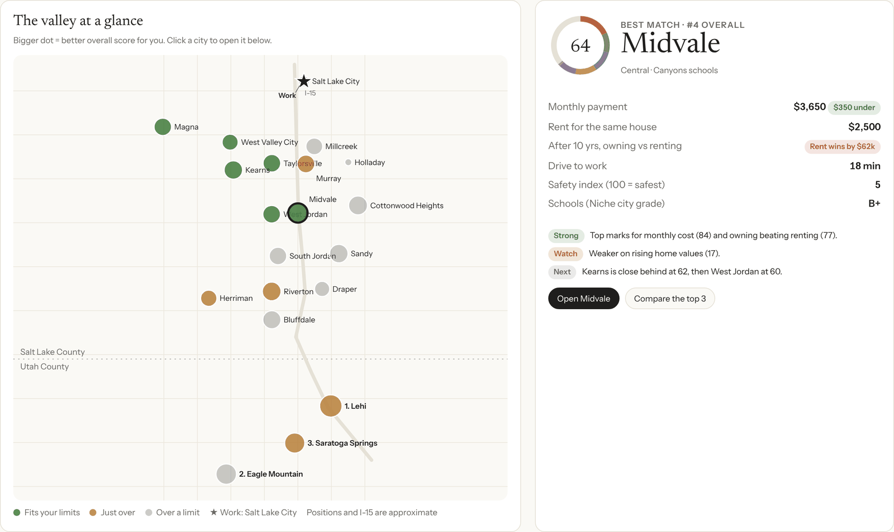
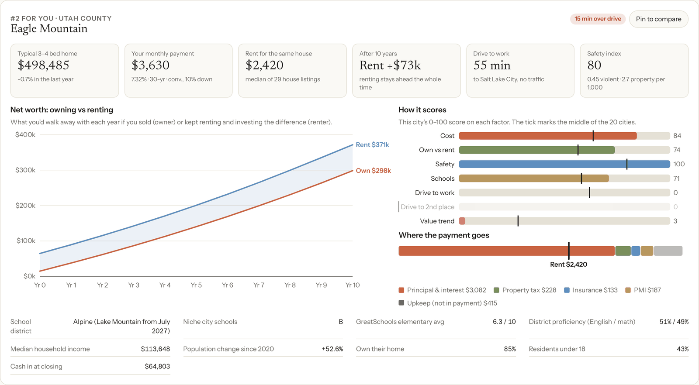
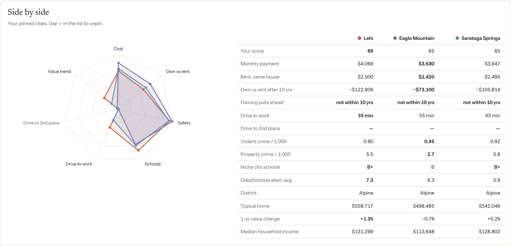
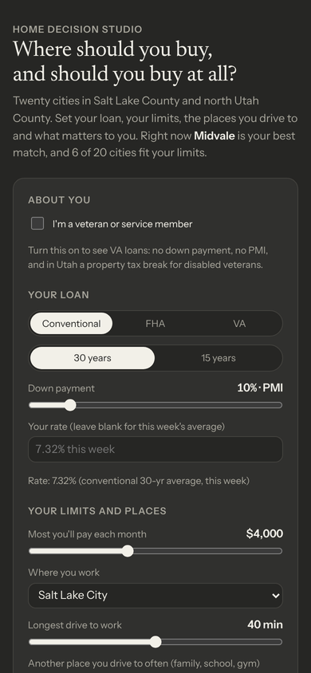

# Home Decision Studio

**Where should you buy a house in the Salt Lake Valley, and should you buy at all?**

[](https://pinedakevin.github.io/Claude_Projects/home-decision-studio/)
[](https://github.com/pinedakevin/Claude_Projects/actions/workflows/refresh-home-decision-studio.yml)

Home Decision Studio is an interactive page that compares 20 cities in Salt Lake County and north Utah County for buying a typical 3–4 bedroom, 2+ bath single-family house. You enter your loan, budget, commute and priorities. It ranks every city for you, shows the real monthly payment, and tells you whether owning beats renting over the years you plan to stay.

It works for first-time buyers, move-up buyers, FHA borrowers and veterans. It runs in your browser, with no account, no sign-up and no tracking.



---

## What it answers

| Question | How the page answers it |
|---|---|
| **What would I actually pay each month?** | The full payment for the typical home in each city: principal and interest, that county's property tax, insurance, PMI or FHA mortgage insurance, and HOA |
| **Is buying better than renting here?** | A year-by-year net-worth race between owning, and renting while investing the difference |
| **Which cities fit my budget and commute?** | Each city is marked as fitting your limits, just over, or over a limit, on the map and in the ranked list |
| **Which city is best *for me*?** | A 0–100 score built from what you say matters: cost, own vs rent, safety, schools, drive times and value trend |
| **How do my top choices compare?** | Pin up to three cities and see them side by side |

## A quick tour

**1. Tell it about you.** Choose conventional, FHA or VA; 30 or 15 years; and your down payment. Set the most you'll pay each month, where you work, how long a drive you'll accept, and a second place you drive to often. Add how many years you'll stay, plus home value growth, rent growth and investment return. Every other assumption (closing costs, insurance, PMI, HOA, upkeep, cost to sell) is under **More assumptions**.

**2. Set what matters.** Give each of the seven factors a weight from 0 to 5. Zero turns a factor off.

**3. Read the results.** The map and the **best match** card update as you go. The best match is the highest-scoring city that fits your budget and drive limit. Below that is all 20 cities, ranked.

**4. Open a city.** You get the typical home price, your payment, rent for the same kind of house, the own-vs-rent chart, where each payment dollar goes, how the city scores on every factor, and its schools and census figures.



**5. Compare.** Pin up to three cities with **+** in the list. A radar chart and a table compare them on every number.



<p align="center"><br><sub>Works on phones, in light and dark mode.</sub></p>

## The cities

| Salt Lake County | | | Utah County |
|---|---|---|---|
| Salt Lake City | Murray | Millcreek | Lehi |
| West Valley City | West Jordan | Holladay | Saratoga Springs |
| Taylorsville | South Jordan | Cottonwood Heights | Eagle Mountain |
| Kearns | Riverton | Midvale | |
| Magna | Herriman | Bluffdale | |
| | Sandy | Draper | |

You can measure drive times to any of these cities, or to one of eight common destinations: the University of Utah, SLC International Airport, Silicon Slopes (Lehi), Provo / BYU, Hill Air Force Base, the SLC VA Medical Center, Intermountain Medical Center and Zions Technology Center.

## How the numbers work

<details>
<summary><b>Monthly payment</b></summary>

- **Typical home**: the average of Zillow's 3-bed, 4-bed and single-family home values for the city (middle third of the market).
- **Rate**: this week's average for your loan type and term, unless you type in your own.
- **Property tax**: Salt Lake County 0.60%, Utah County 0.55% of market value.
- **Insurance**: 0.32% of value a year (adjustable).
- **PMI**: 0.5% of the loan a year on conventional loans with under 20% down, until you reach 20% equity.
- **Upkeep**: 1% of value a year. It's shown separately because it isn't part of the payment, but it is counted in own vs rent.
</details>

<details>
<summary><b>Loan types</b></summary>

| | Conventional | FHA | VA |
|---|---|---|---|
| Minimum down | 3% | 3.5% | 0% |
| Mortgage insurance | PMI under 20% down, until 20% equity | 1.75% upfront, added to the loan, plus 0.50–0.55% a year (0.15–0.40% on 15-year loans). Lasts the life of the loan unless you put 10%+ down, then ends after 11 years | None |
| Other | — | 2026 loan limits: $637,100 (Salt Lake County), $601,450 (Utah County). Where the typical home is above the limit, the down payment is raised to fit and the page says how much more you'd need | Funding fee: 2.15% for a first VA loan (3.3% for later ones) with under 5% down, 1.5% with 5%, 1.25% with 10%+. Exempt with VA disability pay or a Purple Heart |

**Utah's disabled-veteran exemption**: turn on *I'm a veteran* and pick your VA rating. Your rating × $535,459 comes off the home's taxable value (which is 55% of market value).
</details>

<details>
<summary><b>Own vs rent</b></summary>

Simulated month by month over the years you'll stay:

- **The owner** pays the down payment, closing costs and every monthly cost including upkeep. At the end they sell: home value minus selling costs minus the loan balance.
- **The renter** invests the down payment and closing costs instead, and pays rent for the same kind of house (median of live 3–4 bed house listings).
- Each month, whoever's costs are lower invests the difference at your chosen return (5%, 7% or 10%).

The chart shows both net worths every year and the year owning pulls ahead, if it does.
</details>

<details>
<summary><b>Scores</b></summary>

Every factor is scaled 0–100 across the 20 cities, so 100 means best of the group, not perfect.

| Factor | Based on |
|---|---|
| Cost | Your monthly payment |
| Own vs rent | Net-worth gap after the years you'll stay |
| Safety | Violent and property crime rates (NeighborhoodScout, 2024) |
| Schools | Niche grades, district test proficiency and GreatSchools elementary ratings |
| Drive to work | Drive time from the city center, with no traffic |
| Drive to a 2nd place | Same, to the second place you pick |
| Value trend | Zillow's 1-year single-family value change |

Your score is the weighted average of these, using your weights.
</details>

## Data and freshness

The data was last refreshed on the date shown at the bottom of the page.

| Data | Source | How it updates |
|---|---|---|
| Home values | [Zillow Home Value Index](https://www.zillow.com/research/data/) (3-bed, 4-bed, single-family) | Automatically, every week |
| Conventional rates (30 and 15 year) | [Freddie Mac PMMS](https://www.freddiemac.com/pmms) via [FRED](https://fred.stlouisfed.org/series/MORTGAGE30US) | Automatically, every week |
| VA and FHA rates | The conventional rate plus the gap measured from real lender quotes (Oct 2026) | Automatically, every week |
| Rents | Median of 466 live 3–4 bed house listings from Zillow, Realtor.com, UtahRealEstate, Rentler, Zumper and KSL (Oct 2026). Cities with under 15 listings are blended with nearby cities | By hand |
| Crime | NeighborhoodScout (2024), FBI Crime Data Explorer (2025) | By hand |
| Schools | Utah State Board of Education (2025–26), Niche, GreatSchools | By hand |
| Population, income, homeownership | U.S. Census QuickFacts (2025) and ACS 2020–2024 | By hand |
| Drive times | OpenStreetMap routing (OSRM), no traffic | By hand |

### Automatic refresh

[`refresh-home-decision-studio.yml`](../.github/workflows/refresh-home-decision-studio.yml) runs every Friday morning (Mountain time), the day after Freddie Mac publishes new rates. It runs [`scripts/refresh_data.py`](scripts/refresh_data.py), which:

1. downloads Zillow's city-level home value files and takes the latest month for each of the 20 cities;
2. pulls the latest 30- and 15-year rates from FRED, and moves the VA and FHA rates with them;
3. commits only if a number actually changed, and updates the date on the page.

If a source can't be reached, the old numbers stay and the rest still update. To run it now, go to **Actions → Refresh Home Decision Studio data → Run workflow**.

### Updating data by hand

Every number lives in a plain CSV in [`data/`](data/). Edit it on GitHub and commit, and the page picks up the change on the next load.

| File | One row per | Key columns |
|---|---|---|
| `home_values.csv` | city | `zhvi_3bd`, `zhvi_4bd`, `zhvi_sfr`, `zhvi_sfr_sep2025` (value a year earlier) |
| `mortgage_inputs.csv` | setting | `key`, `value`: rates, tax rates, insurance, FHA limits, VA exemption |
| `rent_listings.csv` | city | `listings`, `median_rent`, `pool_median_rent` (nearby-city blend) |
| `crime.csv` | city | `ns_violent_per_1000`, `ns_property_per_1000` |
| `schools.csv` | city | `niche_city_grade`, `gs_elem_avg`, `district_ela_pct`, `district_math_pct` |
| `demographics.csv` | city | population, median income, homeownership, share under 18 |
| `places.csv` | city or destination | `lat`, `lon` (for the map) |
| `drive_matrix.csv` | city × place | drive minutes |
| `meta.json` | — | refresh date and the source line shown on the page |

When you update rents or quotes by hand, also edit the matching line in `meta.json` so the page credits the right date. To change the VA/FHA rate gaps, edit `SPREADS` at the top of `refresh_data.py`.

## Run it yourself

The page is static HTML. The only library it uses is [d3](https://d3js.org) v7.9.0, included in `vendor/`. It loads its data with `fetch`, so it has to be served over http rather than opened as a file:

```bash
git clone https://github.com/pinedakevin/Claude_Projects.git
cd Claude_Projects
python3 -m http.server 8000
# open http://localhost:8000/home-decision-studio/
```

To refresh the data on your own machine:

```bash
pip install requests
python home-decision-studio/scripts/refresh_data.py
```

## Project layout

```
home-decision-studio/
├── index.html              the whole page: layout, styles and logic
├── data/                   every number the page uses (CSV + meta.json)
├── scripts/refresh_data.py weekly refresh of home values and rates
├── vendor/d3.min.js        d3 v7.9.0 (ISC license)
└── docs/                   screenshots for this README
```

## Limits worth knowing

- **It works on city averages.** Prices, schools and safety can differ a lot from one neighborhood to the next, so use this to shorten your list, then go walk the streets.
- **Drive times assume no traffic.** Rush hour on I-15 or Bangerter can double them.
- **Weekly averages aren't quotes.** Type your own lender's rate into the rate box for a real number.
- **VA and FHA rates are estimates** that move with the conventional rate. FHA 15-year rates are the roughest of these.
- **Nobody can predict growth and returns.** Try the low and high settings to see how sensitive the answer is.

Not financial advice. Built with [Claude](https://claude.ai).
