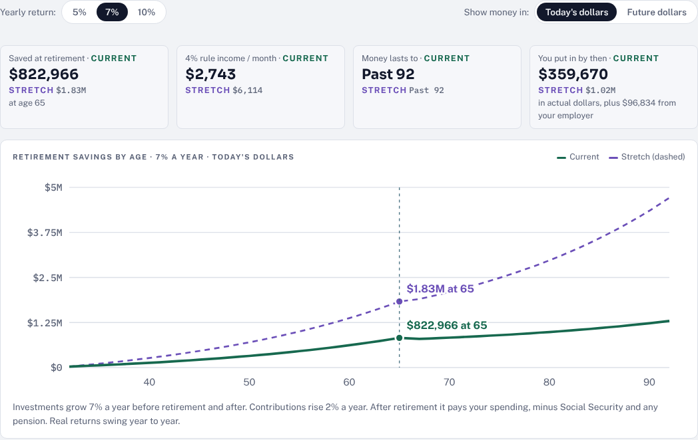
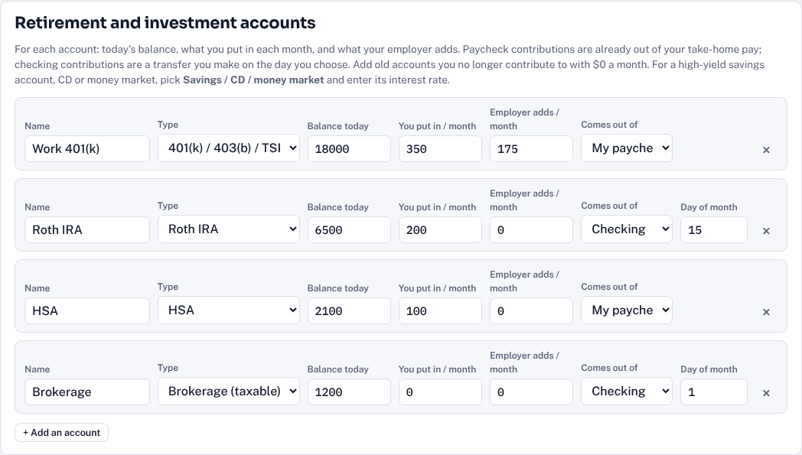
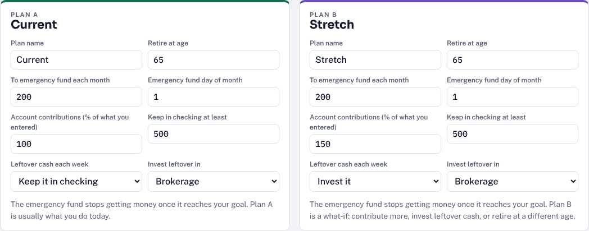
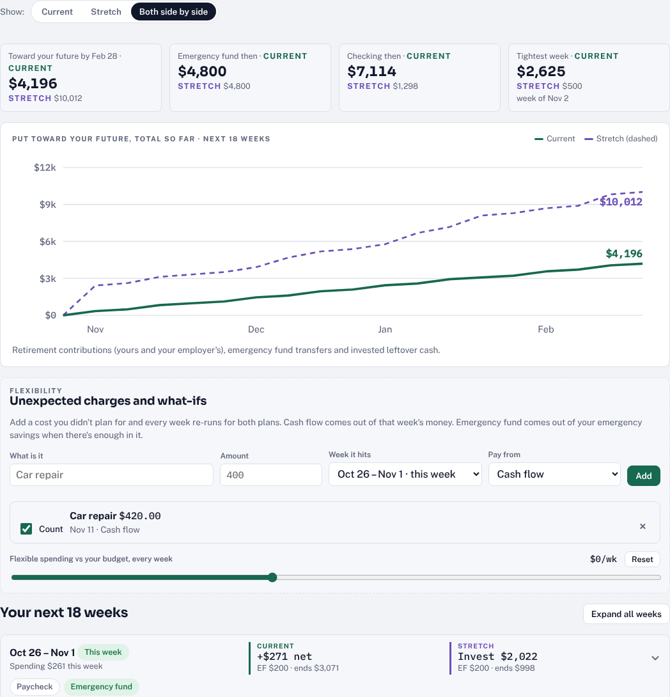
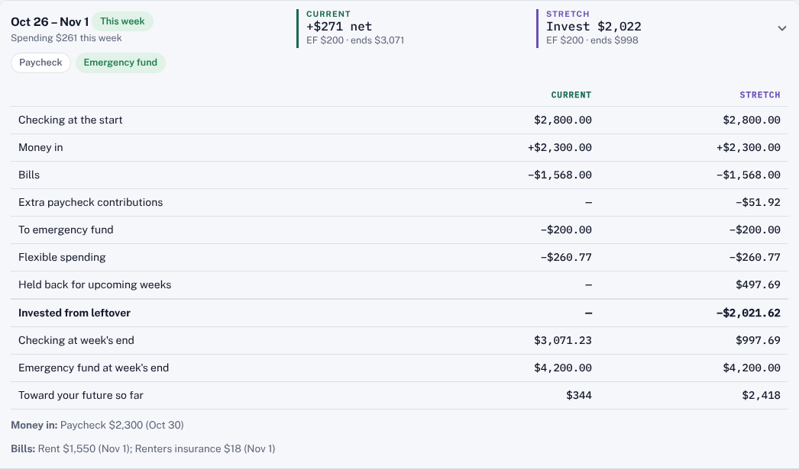
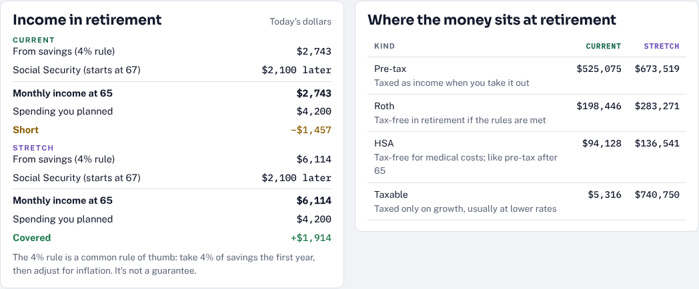
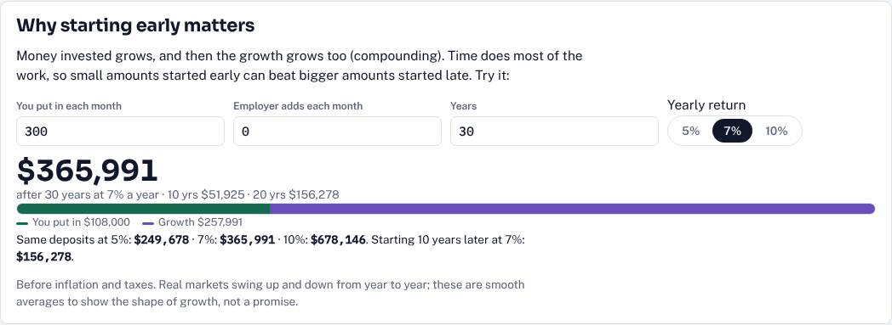
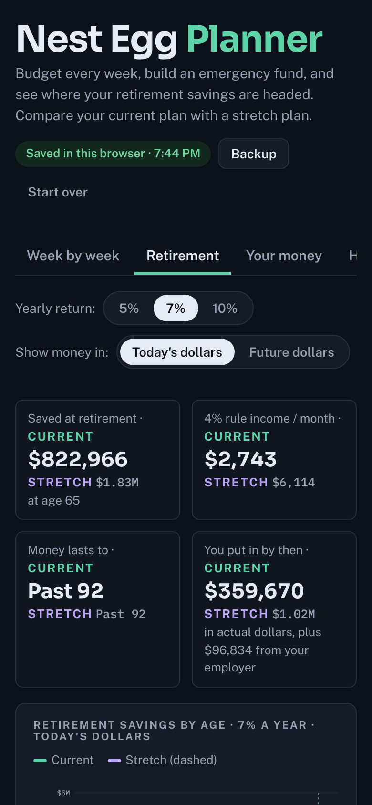

# Nest Egg Planner

**Budget every week, build an emergency fund, and see where your retirement savings are headed.**

[](https://pinedakevin.github.io/Claude_Projects/nest-egg-planner/)

Nest Egg Planner is a free budget and retirement planner. You enter your take-home pay, bills, everyday spending and the accounts you already have, and it shows each week's money in and out, what goes to savings and investing, and how your retirement savings grow by age. It compares two plans side by side, so you can see what contributing more, investing leftover cash, or retiring at a different age would do.

It's the companion to [Payoff Planner](../payoff-planner/), without the debt payoff. It runs entirely in your browser. There's no account, no sign-up and no tracking, and your numbers never leave your device.



---

## What it answers

| Question | How the page answers it |
|---|---|
| **Where does my money go each week?** | Each week's pay, bills, investing from checking, emergency fund transfer, flexible spending and surprise costs, and where checking ends up |
| **How fast will my emergency fund grow?** | A monthly transfer on the day you choose, until it reaches your goal |
| **How much will I have when I retire?** | Every account grows with your contributions, your employer's match and your yearly raises, to the age you choose |
| **Will it last?** | After retirement it pays your monthly spending, minus Social Security and any pension, and shows the age the money lasts to |
| **What if I saved more?** | Two plans you name and set up yourself, compared week by week and age by age |
| **What happens if something unexpected comes up?** | Add a surprise cost to any week, paid from cash flow or the emergency fund, and every week re-runs |
| **Which retirement accounts should I know about?** | A Retirement 101 tab covering 401(k)s, IRAs, Roth vs. Traditional, HSAs, Social Security and more |

## A quick tour

**1. Enter your money.** On **Your money**, add today's checking balance and emergency fund, your take-home pay (weekly, every two weeks, twice a month, monthly, yearly or one-time), your bills, and monthly amounts for flexible spending like groceries, gas and eating out.

**2. Add the accounts you already have.** 401(k), 403(b) or TSP; Roth 401(k); Traditional or Roth IRA; HSA; brokerage; and savings, CD or money market accounts. Each takes today's balance, what you put in each month, what your employer adds, and whether it comes out of your paycheck or from checking. Savings-type accounts grow at their own interest rate. Old accounts you no longer contribute to get $0 a month and still grow.



**3. Tell it about you.** Your age, how long the money should last, monthly spending in retirement (blank uses what you spend today), your Social Security estimate and start age, any pension, your yearly raise and inflation.

**4. Set up two plans.** Each plan has a name, a retirement age, a monthly amount for the emergency fund, how much of your account contributions to make (100% is what you entered), a checking cushion, and whether leftover cash each week stays in checking or gets invested.



**5. Read your weeks.** **Week by week** shows the next 18 weeks (adjustable up to two years), with both plans side by side. Tap a week to see every number behind it.





**6. Look ahead.** **Retirement** shows savings by age at a 5%, 7% or 10% yearly return, in today's dollars or future dollars. It also shows monthly income in retirement against the spending you planned, how much sits in pre-tax, Roth, HSA, taxable and cash accounts, and milestones every five years of age.



**7. Learn the basics.** **Retirement 101** explains the account types in moderate detail for someone new to them, with 2026 IRS limits and a calculator showing how monthly saving grows.



<p align="center"><br><sub>Works on phones, in light and dark mode.</sub></p>

## How the numbers work

<details>
<summary><b>Each week</b></summary>

```
  checking at the start of the week
+ money that lands this week
− bills due this week
− investing from checking (on each account's day)
− transfer to the emergency fund (on the plan's day, until the goal)
− weekly flexible spending   (monthly total × 12 ÷ 52)
− unexpected charges
= what's left this week
```

If a plan invests leftover cash, it first holds back enough for the next few weeks' bills (3 weeks by default) and keeps your checking cushion, then invests the rest in the account you pick. Otherwise the leftover stays in checking.

Raising contributions above 100% lowers take-home pay dollar for dollar for paycheck accounts, which is a little conservative because pre-tax contributions also lower your income tax. Employer matches stay at the amount you entered, since most are capped.
</details>

<details>
<summary><b>Retirement</b></summary>

- Each investment account grows monthly at the return you pick, and savings, CD and money market accounts at their own interest rate, until the retirement age. Your contributions and your employer's rise with your yearly raise. Leftover cash a plan invests is added at its average monthly amount over the next year.
- At retirement, everything is pooled. Each month it pays your planned spending minus Social Security and any pension once they start, all rising with inflation, while the pool keeps growing at the chosen return.
- **Money lasts to** is the age the pool would run out at that pace.
- **4% rule income** is 4% of savings at retirement, divided by 12. It's a common rule of thumb, not a guarantee.
- **Today's dollars** divides future amounts by inflation so they compare to what things cost now.
- Taxes in retirement aren't modeled. The pre-tax, Roth, HSA, taxable and cash split shows what will be taxed when you take it out.
- Retiring before 59½ shows a reminder about early-withdrawal penalties.
</details>

## Your data

- Everything you enter is saved in your browser's local storage on that device. Nothing is sent anywhere.
- **Backup** saves your plan three ways:
  - **Backup file (.json):** restores everything exactly.
  - **Spreadsheet (.csv):** opens in Excel, Google Sheets or Numbers. The first table holds your inputs (settings, both plans, income, bills, spending, accounts, unexpected charges), followed by a retirement summary, every week's budget for both plans, and savings by age. Edit the inputs in the spreadsheet and load the file back in.
  - **Backup code:** copy and paste it anywhere, like a note to yourself.
- **Load a backup** takes either file, here or on another device.
- Clearing your browser data erases the plan, so keep a backup.
- The page opens with a clearly labeled example household. **Start blank** clears it.

## Running it yourself

It's one self-contained `index.html` with no build step. Open it in a browser, or host it anywhere that serves static files. The only outside requests are for Google Fonts, and the page falls back to system fonts without them.

## Notes

This is a planning tool, not financial advice. Markets don't return the same amount every year, and pay, prices and rules change. Use it to compare choices and see the direction, and update your numbers as life changes. Retirement limits are the IRS figures for 2026 and change yearly.

Built with [Claude](https://claude.ai).
