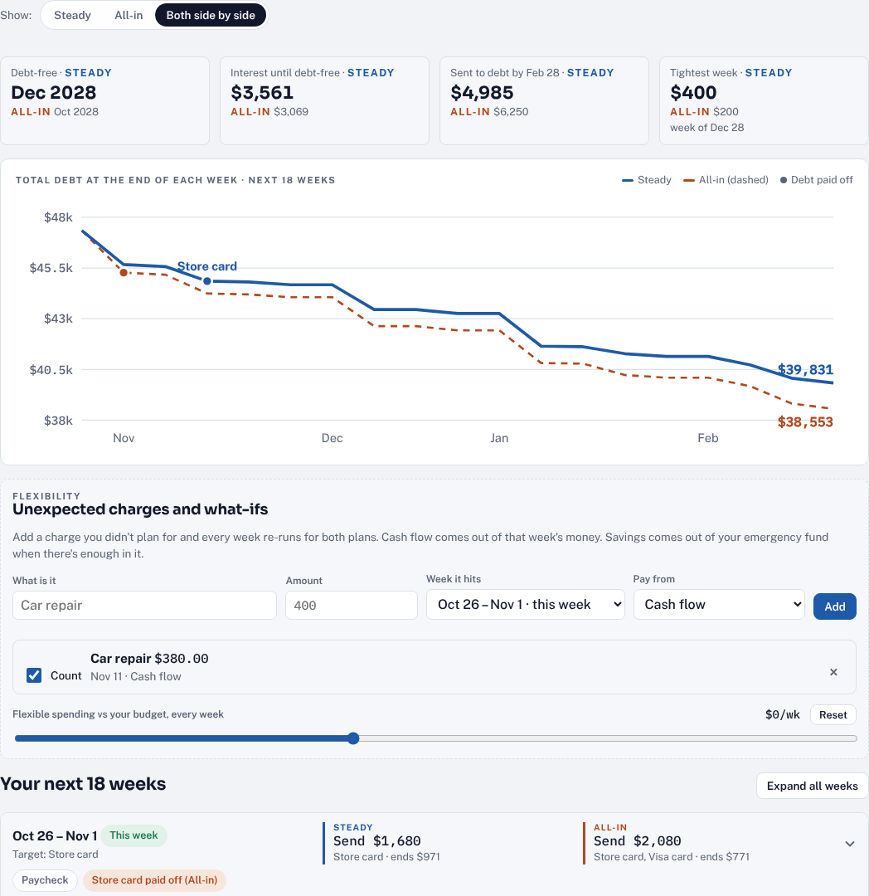
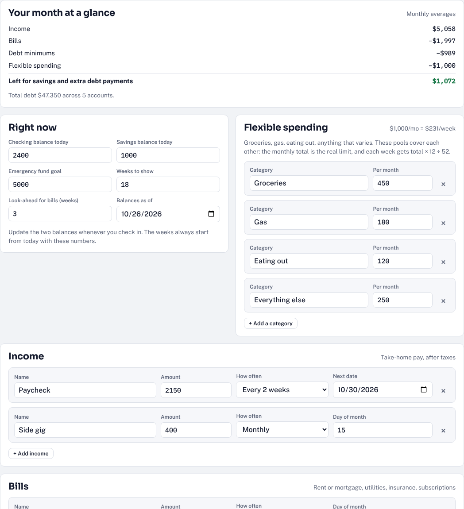
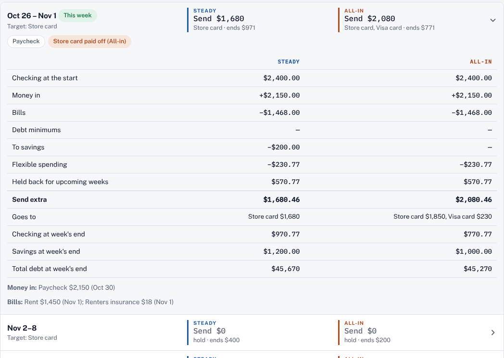
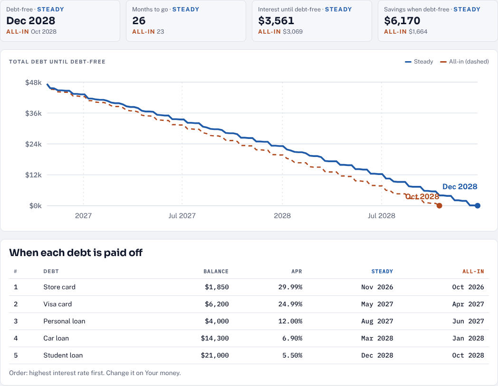
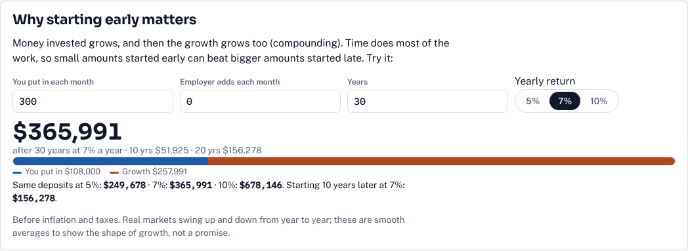
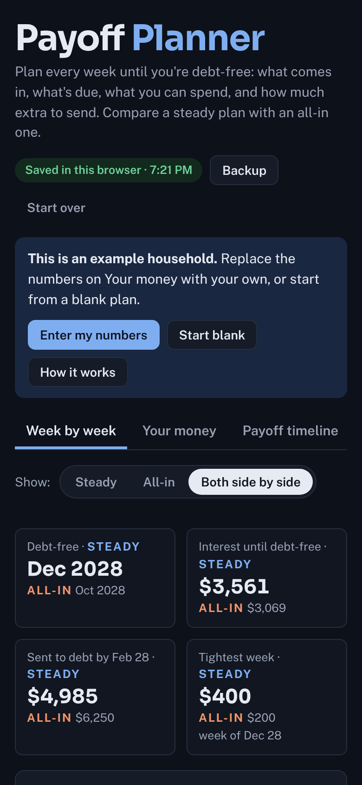

# Payoff Planner

**Plan every week until you're debt-free.**

[](https://pinedakevin.github.io/Claude_Projects/payoff-planner/)

Payoff Planner is a free budget and debt payoff planner that works week by week, the way paychecks and bills actually land. You enter your income, bills, debts and spending, and it tells you how much extra you can send to debt each week, which debt it should go to, and when you'll be debt-free. It compares two plans side by side, handles surprise costs, and includes a plain-English guide to retirement accounts.

It runs entirely in your browser. There's no account, no sign-up and no tracking, and your numbers never leave your device.



---

## What it answers

| Question | How the page answers it |
|---|---|
| **How much can I send to debt this week?** | Each week's money in, minus bills, minimums, savings and flexible spending, minus what's needed for the weeks ahead, minus your checking cushion |
| **Which debt should get it?** | Highest interest first, smallest balance first, or your own order |
| **When will I be debt-free?** | A full payoff timeline for both plans, with the month each debt is gone and total interest |
| **Is it better to save as I go or go all-in on debt?** | Two plans you name and set up yourself, compared week by week and to the finish line |
| **What happens if something unexpected comes up?** | Add a surprise cost to any week, from cash flow or savings, and every week re-runs |
| **What retirement accounts should I know about?** | A Retirement 101 tab covering 401(k)s, IRAs, Roth vs. Traditional, HSAs, Social Security and more, with a growth calculator |

## A quick tour

**1. Enter your money.** On **Your money**, add today's checking and savings, an emergency fund goal, your take-home pay (weekly, every two weeks, twice a month, monthly, yearly or one-time), your bills, and each debt's balance, APR, minimum and due day. Cards on a 0% promo can have an end date. Set monthly amounts for flexible spending like groceries, gas and eating out.



**2. Set up two plans.** Plan A and Plan B each have a name, a monthly savings amount, a savings day, and the least you want to keep in checking. A typical setup is a steady plan that builds savings and an all-in plan that puts nearly everything toward debt.

**3. Read your weeks.** **Week by week** shows the next 18 weeks (adjustable up to two years). Each row shows what to send for each plan and where checking ends up. Tap a week to see every number behind it: paychecks, bills, minimums, savings, spending, money held back, and where the extra goes.



**4. Test what-ifs.** Add an unexpected charge, untick it to compare, or slide flexible spending up or down to see what a little more or less each week does.

**5. See the finish line.** **Payoff timeline** charts total debt to zero for both plans and lists when each debt is paid off.



**6. Learn the basics of retirement.** **Retirement 101** explains the account types in moderate detail for someone new to them, with 2026 IRS limits and a calculator showing how monthly saving grows.



<p align="center"><br><sub>Works on phones, in light and dark mode.</sub></p>

## How each week is figured

```
  checking at the start of the week
+ money that lands this week
− bills and debt minimums due this week
− transfer to savings (on your savings day)
− weekly flexible spending   (monthly total × 12 ÷ 52)
− unexpected charges
− money held back for the next weeks' shortfalls (3 weeks by default)
− your checking floor
= extra to send to the current target debt
```

Holding back for the weeks ahead means a stretch of big bills before the next paycheck never leaves you short. That's why some weeks say **Send $0**. When a debt is paid off, its minimum is freed up and rolls into the next target. Each minimum adds a month of interest at the debt's APR (0% until a promo end date), so the projection stays close to real statements.

## Your data

- Everything you enter is saved in your browser's local storage on that device. Nothing is sent anywhere.
- **Backup** saves your plan as a `.json` file or copies a backup code. Load either one to restore your plan or move it to another device.
- Clearing your browser data erases the plan, so keep a backup.
- The page opens with a clearly labeled example household. **Start blank** clears it.

## Running it yourself

It's one self-contained `index.html` with no build step. Open it in a browser, or host it anywhere that serves static files. The only outside requests are for Google Fonts, and the page falls back to system fonts without them.

## Notes

This is a planning tool, not financial advice. Real minimums shrink as balances fall, interest accrues daily, and paychecks vary, so update your balances each week. Retirement limits are the IRS figures for 2026 and change yearly.

Built with [Claude](https://claude.ai).
